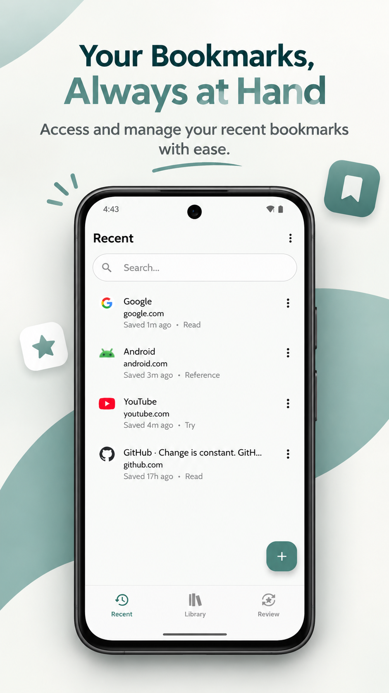
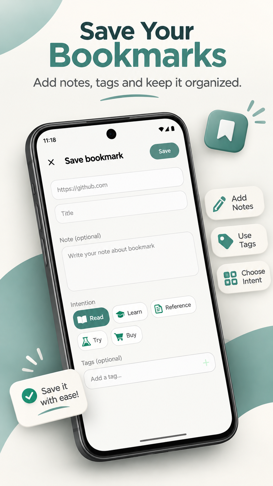
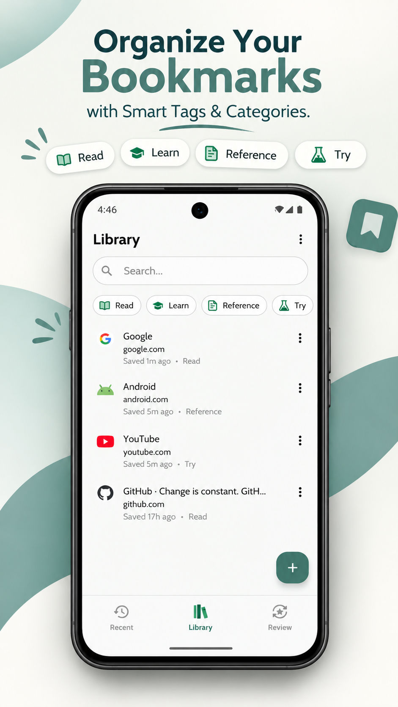
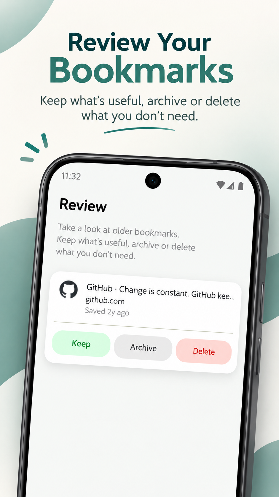
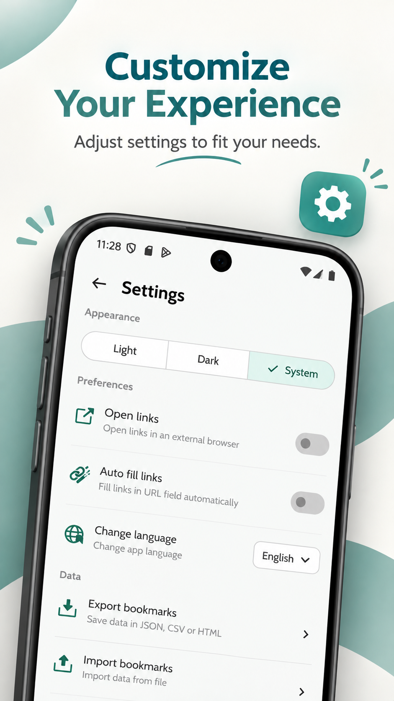

  

<h1 align="center">
  Seenread
</h1>

 

<b>Bookmark manager that lets you save, organize and search</b>

    
    
    
    
    

  <h1>
    Download
  </h1>
  

<b>SHA-256 hash of the signing certificate are provided</b> on the <a href="https://github.com/EmilioAugust/Copypus/releases">GitHub releases page</a>

<h2 align="center">
✨<b>Features</b>
</h2>

- Save bookmarks from any app via Sharing or add manually
- Organize bookmarks with tags or favorites
- Full-text search across titles, URLs, descriptions and tags
- Import/export in standard formats: HTML, JSON, and CSV.

<h2 align="center">
📄 License
</h2>
This project is licensed under the MIT License — see the <a href="https://github.com/emilioaugust/Seenread/blob/main/LICENSE">LICENSE</a> file for details